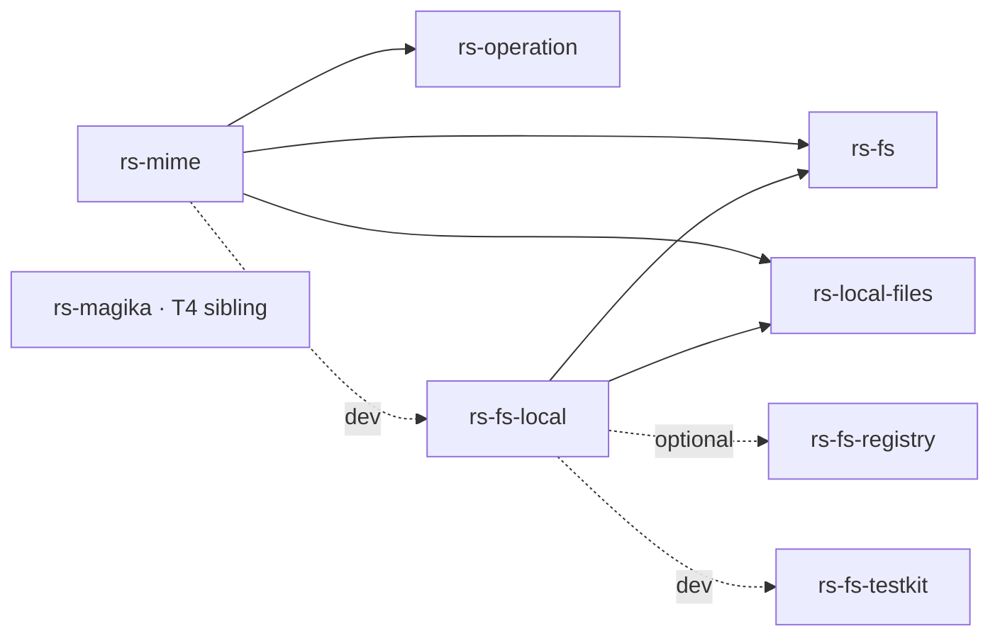
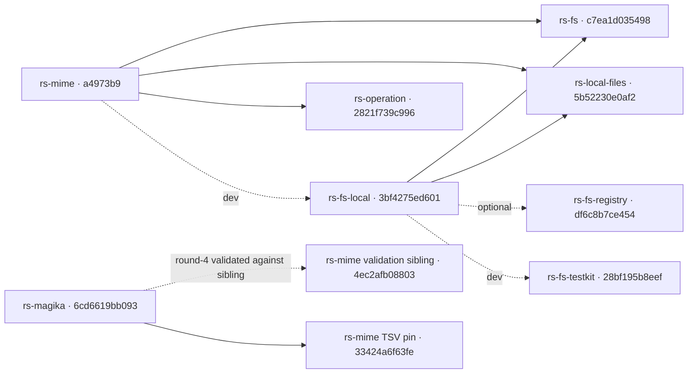

# rs-mime 0.22.0 operation 验收记录

- 验收日期：2026-11-17
- 范围：仅 `rs-mime`；按用户约束，将 `rs-operation` 视为已完成 0.3 重构的公共契约。
- 版本与依赖：`qubit-mime` 0.22.0；正式清单以 `path = "../rs-operation"` 引用 `qubit-operation ^0.3`，`qubit-io ^0.19.6` 使用 crates.io。隔离 worktree 的 CLI 登记禁止复用先前已清理的 `../rs-operation` 登记路径；隔离验证临时将两个 Cargo manifest 指向本任务登记的同一 rs-operation 提交 `985a8727d93155962831d62aca4594e330c94928`，之后已恢复正式相对路径。未改全局 Cargo 配置。整合到源工作区后仍须按正式路径重新解析并验证。
- 文档边界：设计文档与实施计划是输入文件，未纳入变更和提交；本记录仅记录实施与验收证据。

## 2026-11-24 固定依赖图与验收证据索引

下表记录本轮任务布局使用的固定仓库基线。`rs-mime` 是 T6 主仓库；其余 T6 节点来自同组只读依赖树。`rs-magika` 是 T4 同组兄弟仓库，不属于 T6 依赖。后续 T6 最终整合结果尚未写入本记录。

| 仓库 | 固定提交 | 本轮角色 |
| --- | --- | --- |
| `rs-mime` | `4b0ae370ffc10f05f2c38373502a049d991ea568` | T6 主仓库基线 |
| `rs-fs` | `1774ede9bbadd2956e8fa67e3761d59415b4290d` | T6 固定依赖 |
| `rs-fs-local` | `c89dfa900b5f9eb751037c9100e28a622ee52c6a` | T6 固定依赖 |
| `rs-fs-registry` | `df6c8b7ce45495995c0b0ab9d64e14d0b41a8b1c` | T6 固定依赖 |
| `rs-fs-testkit` | `3190325a362f9acf2222795d735381bd5b8a2c17` | T6 固定依赖 |
| `rs-local-files` | `5b52230e0af2997fadc45b5ff48be65b0ca5a70d` | T6 固定依赖 |
| `rs-operation` | `636ad4ebfe9d27b63e886d5935286faf27430301` | T6 固定依赖 |
| `rs-magika` | `729421151769760a8ac1931905a017b0534c3b2a` | T4 同组兄弟仓库 |

已有证据按来源区分：本记录较早章节保留本地 focused、CI、package、coverage 与 audit 结果；下方 T8 条目汇总该轮本地门禁和 GitHub hosted workflow 状态。二者各自对应记录中的提交与依赖图，不代表本轮 T6 最终验收。

## 实施范围

完成计划 M1—M8 所述 rs-mime 变更：定义 operation 领域 API、runtime 与准入/输入归还/预算；实现 repository async backend；提供受管 staging、worker 和 command 生命周期；迁移 file 与 ffprobe/refinement；扩展 provider 注册与消费接口；更新迁移指南、README、版本和 consumer fixtures。保留同步接口，不增加下游仓库验收。

最终审查修复了两处资源报告错误：托管文件 staging 现在把实际写入字节传递到 `MimeCandidates` 和 `MimeDetectionReport`；同步提交报告现在记录真实 owned 输入长度。后者补有 `test_operation_runtime_sync_submission_uses_parent` 断言，前者由 `test_file_operation_runs_managed_command_through_fixed_worker` 断言 staging 字节等于输入字节数。

## 验证证据

命令均在 rs-mime 实施 worktree 执行，`CARGO_HOME=/tmp/rs-mime-99d2bb4b-cargo-home`，不使用全局 Cargo 配置。

| 命令 | 结果 |
| --- | --- |
| `CARGO_HOME=... cargo test --lib detector::file_command_mime_detector::file_operation_tests::test_file_operation_runs_managed_command_through_fixed_worker` | 通过，1/1；实际 `file` 命令 staging 量与输入长度相等。 |
| `CARGO_HOME=... bash .infra/bin/align-ci.sh` | 最终修复轮通过；Rust style、Clippy/check 对齐成功。 |
| `CARGO_HOME=... bash .infra/bin/ci-check.sh` | 修复 staging 统计轮通过：build、182 unit tests、351 integration tests、42 doctests + 1 compile-fail、feature matrix、package verify、coverage 和 audit 均通过。 |
| 同轮 coverage 门禁 | functions 95.07% (1137/1196)，lines 95.55%，regions 95.37%，满足仓库阈值。 |
| 同轮 security audit | 扫描 Cargo.lock 中 89 个 crate 依赖，未报告漏洞。 |
| 同步报告计量新增修复 | 随后再次运行 `align-ci.sh` 通过；最终 CI 通过；同步报告断言已包含在本轮 182 unit tests 与 351 integration tests 中。 |

仓库 CI 没有 downstream all-features 测试；未运行上下游仓库测试。文档 consumer 中的 `qubit-mime ^0.22` 在 crates.io 发布前不能直接从 registry 解析；整合验证将以命令级 Cargo patch 将该 consumer 指向本地项目，正式清单和全局配置不作改写。

## 已验证的主要行为

- Runtime 支持 root/child 与同步/异步受管提交、停止与观察；准入失败保留输入，shared budget 约束内存、读取及 staging。
- Provider 输入基于已打开对象读取；测试覆盖路径替换快照、driver 丢失保留 pending 与随机访问 extent。
- Repository 使用有界异步匹配；provider 注册不触发执行器启动，sync-only provider 不静默回退到同步 async hook。
- Staging/command 生命周期使用 ResourceRef、受管 cleanup 和 recovery；覆盖取消、短读/哨兵、额度边界、parent/child 资源关系、cleanup 重试和未消费 outcome。
- File backend 明确要求完整内容；ffprobe refinement 使用受管输入并复用 staging 额度，不在 async 路径调用同步 classifier。

## 有边界的环境说明

隔离工作区的正式 `../rs-operation` 位置曾登记并清理；CLI 明确禁止在同一任务中复用已清理登记位置，因此 worktree 中无法直接以正式路径运行 Cargo。验证使用了任务登记的 rs-operation worktree，commit 为 `985a8727d93155962831d62aca4594e330c94928`，并在最终集成源工作区恢复正式相对依赖后再次解析、构建及运行必要 CI。此路径限制不改变交付清单中的正式依赖关系。

## 2026-11-17 MIME-001—004 实施与验证

- 实施提交：`691056ff865fc6b9ed0364e834526e2060603fb5`（`fix(mime): align managed detection reporting and packaging`）。独立 review 未发现 Critical 或 Important 问题。
- MIME-001：最终许可释放时，按许可对象身份清理分配索引；测试覆盖 alias 中间释放、最终释放与重新预约、弱引用计数、普通 owned/staging 许可、旧许可不移除替代项及 barrier 并发。
- MIME-002：双语指南列出 repository、file 和 sync-only 自定义 provider 的受管异步能力及限制。
- MIME-003：包清单精确包含验收记录；新测试从 `cargo package --list --allow-dirty` 读取实际包文件并验证四份 Markdown 入口的相对链接闭包。本轮设计和计划文件未进入包清单。
- MIME-004：确认同步 repository 报告原先把受 `max_test_bytes` 限制的匹配报告为 `Complete`。现在报告实际匹配窗口为 `Prefix(n)`；唯一文件名 `PreferFilename` 在同步及受管异步 repository 入口均短路为 `Prefix(0)`，Provider 不会因此读取前缀。`ContentFirst` 与 `VerifyContent` 仍执行有界内容 matcher。`InputExtent` 表示输入完整性，`InspectedExtent` 表示匹配窗口。

本轮 focused 与最终集成 worktree 验证命令如下：

| 命令 | 结果 |
| --- | --- |
| `cargo test --lib mime_budget` | 通过，24 tests。旧逻辑的索引残留回归曾按预期失败；修复后通过。 |
| `cargo test --test package_document_links_tests` | 通过，3 tests（2 个解析单元测试和 1 个包清单集成测试）。 |
| `cargo test --test mod operation_runtime` | 通过，17 tests；旧同步范围行为曾复现 `Complete` 与期望有界 `Prefix(18729)` 的差异。 |
| `./.infra/bin/align-ci.sh` | 通过；Rust style fix、Clippy/check 对齐成功。 |
| `./.infra/bin/style-check.sh` | 通过，机械风格检查无发现。 |
| `cargo test` | 通过：352 integration tests、3 package-link tests、42 doctests 和 1 compile-fail doctest 均成功。 |
| `cargo test --all-features` | 通过，测试与 doctest 均成功。 |
| `cargo doc --no-deps --all-features` | 通过。 |
| `./.infra/bin/ci-check.sh` | 通过：lock/build、feature matrix、测试、文档、package verification、coverage、security audit 均成功。 |

最终 coverage：functions 95.10%（1144/1203），lines 95.58%（9585/10028），regions 95.40%（16387/17177），满足仓库门槛。Security audit 扫描 89 个 Cargo.lock 依赖，未报告漏洞。package verification 成功打包并验证 229 个文件。本轮隔离验证使用登记的相对依赖 worktree `../rs-operation`，精确提交 `da023d6105aae13f1689d789f0e4a6219ad667a1`；正式 manifest 未改写。

### Cargo 依赖解析修正

用户指出 Cargo 不应解析上级目录中的 `rust-common/Cargo.toml`，并明确要求从 crates.io 依赖 `qubit-operation = "^0.3"`。已将 `Cargo.toml` 的依赖改为该 registry 版本范围，并增加空 `[workspace]`，使 `rs-mime` 成为独立 workspace 根，Cargo 不再向父目录探测 workspace/package。`Cargo.lock` 锁定 crates.io `qubit-operation 0.3.0`。

最终配置解析验证：`cargo locate-project --workspace --manifest-path Cargo.toml --message-format plain` 返回本 crate 的 `Cargo.toml`；`cargo metadata --manifest-path Cargo.toml --format-version 1` 和 `cargo tree --manifest-path Cargo.toml --invert qubit-operation` 均确认依赖来源为 crates.io `qubit-operation 0.3.0`。此前依赖本地路径 worktree 的验证记录描述的是修正前状态，不代表最终交付配置。

## 2026-11-17 MIME-005—007 生命周期复核

本节仅记录本轮实施证据，不改写上方 MIME-001—004 的历史验证结果。

- MIME-005：增加 `ReadTreeContext` 最终释放时的精确弱索引注销。回归覆盖连续根请求、活跃上下文、同 ID 替代绑定、多 ID、registry 先销毁及 poison 锁恢复。旧逻辑新增索引长度断言曾失败；修复后 focused 测试通过。
- MIME-006：顺序外部父子请求回归在修复前确认第二个子请求绕过了累计读取上限；父操作保持存活，但第一个子请求完成 settlement 并释放 handle 后才提交第二个。修复后父资源域保留一个读取预算锚点，顺序及并发子请求共享首次确定的累计上限。不同根／父仍有独立额度；父资源条目容量不足、停止或结束时以 `ReadBudgetBinding` 携带错误种类拒绝并归还原输入。
- MIME-007：barrier 回归确认旧实现会在 execution port 的 `prepare()` 返回前报告 ready，并接受准备中的 root/child 提交。修复后仅在执行端成功后发布 ready；失败仍可重试，prepare 与 shutdown 由同一生命周期锁串行。
- 兼容性：未更改 `qubit-operation = "^0.3"` registry 依赖或独立 workspace。`MimeSubmitRejection` 新增 `ReadBudgetBinding(ResourceManageErrorKind)`，穷尽匹配的下游调用方需要处理这一新拒绝种类；失败 input 由 `MimeSubmitFailure` 原样持有。无需升级 `rs-magika`。

### 本轮验证命令

| 命令 | 结果 |
| --- | --- |
| `cargo test --lib read_tree` | 通过；包含根索引注销、外部父预算复用、失效弱索引替换及并发注册覆盖。 |
| `cargo test --lib mime_execution_services` | 通过，18 tests；覆盖 prepare 状态发布、失败重试及 prepare/shutdown 竞争。 |
| `cargo test --test mod sequential_mime_children_keep_external_parent_read_budget -- --nocapture` | 修复前因第二个子请求未被预算拒绝而失败；修复后通过，1 test。 |
| `cargo test --test mod external_parent_read_budget -- --nocapture` | 通过，2 tests，验证 binding 错误种类及原 input 归还。 |
| `cargo test --test mod concurrent_external_parent_children_share_one_budget_binding -- --nocapture` | 通过，1 test，验证并发 child 共用一个父预算锚点。 |
| `./.infra/bin/align-ci.sh` | 通过；包含 Rust 风格修复和对齐检查。 |
| `./.infra/bin/style-check.sh` | 通过。 |
| `cargo test` / `cargo test --all-features` | 通过；完整 CI 分别运行默认与 feature-matrix 测试，200 个库测试、355 个 mod 集成测试均通过。 |
| `cargo doc --no-deps --all-features` | 通过；完整 CI 文档检查通过。 |
| `./.infra/bin/coverage.sh --output /tmp/rs-mime-coverage-final5.json` | 通过；functions 95.07% (1195/1257)，lines 95.60% (10040/10502)，regions 95.48% (17293/18111)。 |
| `./.infra/bin/ci-check.sh` | 最终门禁通过；包含 style、build、test、release build、feature matrix、package、coverage 与 audit。 |

## 2026-11-17 MIME-008/009 并发关闭与 Prefix 分类

- MIME-008：`FixedMimeExecutionPort` 使用独立 shutdown 结果锁串行关闭调用，并在 worker join 完成后缓存成功／失败终态。锁在 join 时不占用 running 或 queue 锁；并发关闭调用复用实际 worker 退出结果，dispatch 在关闭期间仍及时拒绝。shutdown Rustdoc 明确只能从 worker pool 外部同步上下文调用。
- MIME-009：旧受管路径的真实 Ogg fixture 命中 `ogg` 精细映射后，会把 `Prefix` 送入 async classifier 并得到 `CompleteContentRequired`。修复后，受管 `repository` 的 `Prefix` 返回基础 MIME，不调用 classifier；同一 fixture 的 `Complete` 对照仍调用 classifier 并按 `AudioOnly` 结果返回映射类型。`mime_submission.rs` 中非随机访问 Provider 经 `read_prefix` 读取后会构造成 `BorrowedMimeInput::Bytes { extent: Prefix }`，同一 core 分支覆盖该路径。
- 双语用户指南同步说明：受管前缀不会做完整媒体精化；需要精化时提供完整输入。并发关闭会等待 worker 实际退出，且调用位置须在 worker pool 外部。

本轮集成提交：`d47ef95`（指南）、`d598446`（并发 shutdown）、`d734d87`（Prefix 精化）。并发关闭回归曾在旧实现下因第二个 shutdown 提前返回而失败；受管 Prefix 对照曾在旧实现下以 `CompleteContentRequired` 失败。整合后 focused 验证如下：

| 命令 | 结果 |
| --- | --- |
| `cargo test --lib fixed_mime_execution_port` | 通过，10 tests。 |
| `cargo test --test mod operation_runtime` | 通过，21 tests，包含映射命中的 Prefix／Complete classifier 调用次数对照。 |
| `cargo test --test mod prefix_paths_skip_classifier` | 通过，1 test。 |
| `git diff --check` | 通过。 |

并发测试随后依据独立 review 调整为由第二个调用先尝试获取 shutdown 结果锁；只有实际观察到锁被占用时才发出同步信号，之后检查 worker 释放前调用未提前返回。无论检查结果如何都会释放 job 并 join 两个线程。调整后再次运行 `cargo test --lib fixed_mime_execution_port`，10 tests 通过。完整格式对齐、style、默认／all-features 测试、文档、coverage、audit 与 CI 结果将在下方补录。

## 2026-11-17 MIME-010 精细分类暂存峰值报告

- T1 请求计量原语提交：`f0d53e4`（`fix(mime): track request staging usage`）。每个 `ReadTreeContext` 单独持有请求暂存 tracker；RAII 许可释放当前计量但保留峰值。global staging 额度、请求计量溢出回滚、无 tracker 路径和 poison 锁恢复均有测试。
- T2 报告修复提交：`443c943`（`fix(mime): report request staging peak`）。受管 FFprobe classifier 按 operation 选择 tracker，最终报告取 backend 原始值与请求峰值的较大值，避免重复相加。Prefix 不执行完整分类且报告零值；自定义 backend 的外部暂存仍由其 `MimeCandidates` 提供证据。
- 新增真实 Ogg runtime 回归：通过 repository 精细映射和真实 FFprobe classifier（注入可控命令执行器），分类结果为 `audio/x-vorbis+ogg`，`staging_bytes` 与输入长度相等。
- 独立 review 指出并发报告隔离仍缺端到端断言，随后以 `4dc0ddf` 补测：两个不同大小的 Ogg 请求同时持有 staging 许可，由双到达异步 gate 确认重叠，不用 sleep；释放后分别断言各自 MIME 和各自输入长度。

| 命令 | 结果 |
| --- | --- |
| `cargo test --lib request_staging` | 通过，4 tests。 |
| `cargo test --lib staging_budget` | 通过，8 tests。 |
| `cargo test --lib test_runtime_report_includes_real_ffprobe_staging_for_ogg_refinement` | 通过，1 test；精细 MIME 与报告暂存量均有断言。 |
| `cargo test --test mod operation_runtime` | 通过，21 tests；包含 Prefix 零暂存报告。 |
| `cargo test --lib test_concurrent_runtime_reports_keep_request_staging_isolated` | 通过，1 test；两种输入并发重叠并分别报告自身峰值。 |
| `cargo test --lib async_operation_tests` | 通过，8 tests。 |

该历史检查点之后的 round-4 align、完整 CI、coverage、audit 与候选 worktree 消费者结果见本节下方；原工作区合并后的 CI 尚待执行。

## 2026-11-18 MIME-011/012 异步注册封闭与回调锁边界

- MIME-011：两个 Registry 的 `seal()` 与异步注册共享异步表写锁；封闭状态仍由 `ProviderRegistry` 唯一维护。封闭后通过 clone 注册会得到明确错误，已有 canonical ID 与 alias 仍可创建。
- MIME-012：异步创建只在读锁内按选择顺序克隆 provider 和缓存的 canonical ID，随后在锁外调用 factory。冲突诊断也使用缓存身份，不在异步表锁内调用既有 provider 的 descriptor。
- 新增 detector 与 classifier 回调重入测试：factory 委托另一个线程注册不同 provider，并用 channel 有界观测注册是否在回调返回前完成；此测试不靠 sleep 等待。
- 双语指南说明应先完成注册再封闭、克隆共享封闭状态和创建使用 provider 快照。

### 本轮验证

#### MIME-018/019/020（2026-11-18）

- MIME-018：只有精确的内建 `RepositoryMimeDetectorProvider` 类型才绑定内建 MIME repository。canonical ID、alias 和 selector chain 均保留 Provider filename 的短路；同 ID 的自定义 provider 仍实际执行，不会误用内建 repository。repository 初始化延迟到 factory 返回后，避免在注册表锁内做 I/O。
- MIME-019：文档 consumer workflow 将主 crate 与所有本地路径依赖检出到保持相对布局的 `sources/` 目录，并固定每个依赖提交。尚未发布的 `qubit-mime ^0.22` fixture 改为指向本地 crate；fixture lockfile 已同步，根 lockfile 未改。
- MIME-020：glob 简单扩展名索引仅把 matcher 实际使用的 `*`、`?`、`[` 视为模式语法。`!`、`^`、`{`、`}`、`]` 等普通字符扩展名现在能正确参与精确索引。

主仓库任务提交：`279b60a`、`252afff`、`edb1c73`。只读依赖工作副本固定为 rs-fs `bbb7a5d269f2f3a955fcd25839177eae4795898f`、rs-fs-local `1067ff1ffe75376f2349c2a484ccf2423e29d20e`、rs-fs-registry `f979cd4425d9a50ea0a3ca5544ab94a8bffad31b`、rs-fs-testkit `72af3d22362de9884c77e0bcaadbccfca4725a35`、rs-operation `7fcda0375286f9466dbdfbb63d720d10c88fb423`。

| 命令 | 结果 |
| --- | --- |
| `.infra/bin/align-ci.sh` | 通过；Rust 格式、文档与仓库对齐检查通过。 |
| `.infra/bin/style-check.sh` | 通过。 |
| `.infra/bin/ci-check.sh` | 通过；库测试 193、集成测试 387、文档测试 64 及 compile-fail 测试通过，功能矩阵、文档和审计通过。 |
| `.infra/bin/ci-check.sh` coverage 汇总 | functions 95.03%（1186/1248），lines 95.55%（9913/10375），regions 95.49%（16947/17747），均达到门槛。 |
| `cargo check --manifest-path tests/fixtures/documentation_consumer/Cargo.toml --locked` | 通过。 |
| `cargo check --manifest-path tests/fixtures/operation_consumer/Cargo.toml --locked` | 通过。 |
| `cargo tree --locked --manifest-path tests/fixtures/operation_consumer/Cargo.toml` | 通过；确认解析到本地 rs-mime、rs-fs、rs-operation 路径。 |
| `git diff --check` | 通过。 |

rs-magika 的动态加载 CI 同步固定上述依赖及 rs-mime `edb1c737dc4efac1bbff1e673fbc70a73d31882f`。原 workflow 使用的 ONNX Runtime GitHub tarball URL 返回 404；因此改为下载带 SHA-256 校验的官方 1.24.2 CPython 3.11 manylinux wheel，并在本机用该产物实际运行 dynamic-loader fixture。rs-magika `.infra/bin/align-ci.sh`、`.infra/bin/ci-check.sh`、动态加载 feature 自检、README consumer、动态加载 fixture 均通过；覆盖率 functions 90.02%、lines 93.68%、regions 94.45%，依赖审计通过。

## 2026-11-24 T8 状态：本地门禁通过，Rust CI hosted bootstrap 待复验

本节记录登记提交 `398ecdd15210013fcd1942a0fb834d87a119b2c9` 的 T8 本地验证，以及随后 GitHub 工作流的状态。T8 本地 `.infra/bin/ci-check.sh` 完成；Cargo 根 crate 和两个真实 consumer fixture 均通过。GitHub 文档 consumer 工作流先通过，之后 Rust CI 在 `./update-infra.sh --check` 启动门禁因本地依赖 TSV 仍列在 upstream profile 快照中而失败。profile/快照归属已在本地修正，两个 workflow 启动步骤通过；GitHub Rust CI 尚未复验。

### T8 本地整合门禁

| 验证范围 | 结果 |
| --- | --- |
| 原工作区 `398ecdd`：`.infra/bin/ci-check.sh` | 通过；测试、feature matrix、package verification、coverage 与 audit 均成功。coverage：functions 97.33%（983/1010）、lines 95.66%（12176/12729）、regions 95.68%（20916/21860）。 |
| 登记 `main` 树：`.infra/bin/ci-check.sh` | 通过；235 个单元测试、406 个集成测试、1 个 operation API consumer 测试、3 个 package document link 测试通过；coverage：functions 97.33%、lines 95.62%、regions 95.65%；coverage 门槛和 audit 通过。 |
| Cargo consumers | 根 crate、documentation consumer、operation consumer 的 locked 本地候选检查通过；GitHub 文档工作流运行 documentation consumer fixture 并编译 operation consumer 均通过。 |
| GitHub 工作流 | 文档 consumer 工作流先通过。随后 Rust CI 于 2026-11-24 00:48 UTC 在 `./update-infra.sh --check` 失败，报告 `.infra/ci/local-path-dependencies.tsv` 与 upstream snapshot 不符。profile/快照修正后，本地该检查退出码 0，文档 consumer 的依赖准备启动步骤退出码 0；GitHub Rust CI 仍待复验。 |

MIME-021–038 的逐项结论未在本记录中展开，不能以未附地址的外部报告作为验收依据。纯 registry 发布解析仍受 `qubit-operation 0.3.2` 尚未发布限制；系统未安装真实 `ffprobe`，受控 fake 命令测试不替代真实系统命令验证。此状态不对 rs-magika 或 hosted 后续运行作结论。

### operation 依赖候选与结果边界

根 crate 和两个消费者当前都使用本地 `qubit-operation 0.3.2` 候选，源提交为 `636ad4ebfe9d27b63e886d5935286faf27430301`。候选提供组级 recovery handle 快照，使关闭门禁读取完整组账本，不依赖可能受诊断长度限制的单个 settlement 报告。

检测业务结果、单 operation 资源结算、MIME 服务结算和 operation group Drain 是不同观察结果：`wait_outcome()` 返回 MIME 结果，`wait_settlement()` 报告该 operation 的资源／恢复责任，`wait_services_settled()` 等待已跟踪操作完成结算，`wait_group_shutdown()` 返回最终组关闭报告。组级 recovery 快照用于处理完整恢复责任，不能用业务成功或单项诊断报告替代。

### 本地依赖图验证

三个依赖图均以 `--locked --offline` 解析到登记路径中的 `qubit-operation 0.3.2`，没有解析成另一份同版本包：

| 范围 | 命令 | 结果 |
| --- | --- | --- |
| 根 crate | `cargo check --locked --offline` | 通过，退出码 0。 |
| 文档消费者 | `cargo check --locked --offline --manifest-path tests/fixtures/documentation_consumer/Cargo.toml` | 通过，退出码 0；无未使用的编译示例警告。 |
| operation 消费者 | `cargo check --locked --offline --manifest-path tests/fixtures/operation_consumer/Cargo.toml` | 通过，退出码 0。 |

对三个清单运行 `cargo tree --locked --offline -i qubit-operation` 均显示同一个本地 `0.3.2` 路径候选。两个 fixture 的运行／消费验证属于本地候选验证。纯 registry 发布解析仍待 `qubit-operation 0.3.2` 发布后执行；本地 path 覆盖不能证明发布包解析。

### 命令环境与受控回归

当前系统 `command -v ffprobe` 退出码为 1，没有可用的系统 `ffprobe`，因此没有将真实系统命令执行记作通过。受控回归使用 `PathEnvGuard` 注入临时 fake `ffprobe`：`cargo test --locked --offline --test mod test_public_ffprobe_async_provider_classifies_complete_bytes` 通过，1 test；它检查完整输入分类及相关拒绝路径。固定 worker 容量回归也由受控 executor 覆盖；T3 提交 `a5b6c45` 的 `test_full_command_queue_returns_typed_busy_after_preserving_lifecycle` 通过，队列满时返回 typed Busy 并保留生命周期责任。它们不替代系统 `ffprobe` 可用时的真实命令验证。

### MIME-038：异步 magic matcher 让出执行器

修复前，单 worker 在 65,540 字节输入、宽 `0..=65,535` offset 的高成本负向规则上可连续占用约 150–230 ms/poll；显式驱动的 20 ms stop 信号约在 147.17 ms 才可观察到。提交 `aa1b8c0` 将异步 matcher 的 offset 与宽值比较工作按 4,096 个单元分片并在分片间检查停止状态，同时以显式栈保留原嵌套顺序。

以下是同一 Linux x86_64、Rust 1.94.0、单 worker 合成 workload 的两个构建 profile 结果。工作负载为 65,540 字节、128 条规则、每条四个宽 offset 负向 matcher；总时间统计两次异步查询：

| Profile | 两次异步查询总时间（同步对照） | 最大单次 poll | 同 worker 探针延迟 | 显式 20 ms stop 的观察时间 |
| --- | ---: | ---: | ---: | ---: |
| debug | 2.859–3.018 s（同步 4.933 s） | 1.206–1.247 ms | 0.396–0.665 ms | 20.37 ms |
| release | 114.1–118.2 ms（同步 143.2 ms） | 52–56 μs | 29–62 μs | 20.06 ms |

该 workload 的 debug 最大 poll 从基线约 150–230 ms 降到约 1.2 ms，约两个数量级；release 最大 poll 为
52–56 μs。这是特定合成规则和输入上的调度／吞吐探测，不代表所有 MIME 数据的性能预测。T4 将 managed
async detection 的 deadline 和 stop signal 与 backend future 一起驱动；matcher 仍只在协作批次边界检查停止。
下面列出 T4 假钟回归覆盖。Repository 构建与查询的独立测量见[基准记录](../benches/repository_matching.md)，
不应与上方 synthetic matcher poll 数据混为一谈。T8 的本地整合门禁与 clean sibling 布局验证已记录于上文；
GitHub Rust CI 需在提交 profile/快照修复后复验。

## 2026-11-24 T4：受管操作 deadline 与停止协作

T4 提交 `b761851` 为 managed async detection 同时轮询 operation stop 与 deadline signal。deadline 到期可以唤醒
仍挂起且不会自行唤醒的 provider read，operation 以 `Stopped(Timeout)` 结束；回归还确认 reader 在 settlement
后释放。repository matcher 在协作批次间检查停止状态，因此 deadline 能在批次边界停止大量规则匹配。用户取消与
deadline 竞争时，已接受的 `UserCancelled` 原因保留。

对应的受控回归为 `test_managed_deadline_wakes_never_waking_provider_read_and_releases_reader`、
`test_managed_deadline_stops_cooperative_repository_matching` 和
`test_user_cancel_wins_when_racing_a_managed_deadline`。它们使用假钟及受控 provider，不证明真实系统命令已运行
或被 deadline 终止。

deadline 或 stop 使 async detection future 返回，不代表已经派发的 command 或 staging worker job 也已退出。它们
继续持有 operation 资源，直到 worker 实际结算；应用仍须等待 settlement，并解决或转交恢复责任，之后才能停止服务。
同步子操作没有可供 runtime 抢占的 async future，只在具体同步实现的协作检查点观察停止请求。
## MIME-039—055 逐项变更与阶段证据

> 本片段对应固定整合候选 `rs-mime 7cf770cd671f725b8ef24fc5ab91f4a2c0598514`。表中的 focused 回归和 T6 文档检查使用各阶段已验证结果；这里列出可复核的测试入口，不表示本片段生成时重新运行了全量验证。最终 CI、原工作区整合和 hosted workflow 证据留待最终验收补录。

| 条目 | 变更位置与端口 | 阶段回归证据 | 兼容性／迁移 |
| --- | --- | --- | --- |
| MIME-039 组关闭准入 | `rs-operation/src/v02/manager/core/internal/manager_core.rs`、`group_core.rs`；rs-mime `src/detector/mime_execution_services/mime_shutdown_observer.rs` | `rs-operation/tests/v03_scope_tests.rs::test_cached_parent_group_view_rejects_closed_foreign_group_and_keeps_true_descendants`；rs-mime `tests/detector/operation_runtime_tests.rs::test_operation_runtime_drain_accepts_external_parent_child_until_stop_freezes` | 关闭后，外部 parent 不能首次加入已关闭组；已接纳的组内父 scope 仍可派发后代。需在关闭前完成新的外部准入，或从已接纳父 scope 派发必要后代；沿用既有错误类型。 |
| MIME-040 worker 准备与关闭 | `src/command_execution/mime_execution_worker/fixed_mime_execution_port.rs`；`MimeExecutionPort` prepare/dispatch/shutdown 边界 | `test_worker_side_final_drop_does_not_join_other_workers`、`test_shutdown_waits_for_in_progress_prepare_and_worker_cleanup`、`test_full_queue_returns_unaccepted_job_while_accepted_work_drains`；`tests/detector/operation_runtime_tests.rs::test_operation_runtime_prepare_retries_after_failure_and_rejects_after_shutdown` | worker 启动仍需显式 `prepare()`；池外 `shutdown()` 负责 join，池内最后 owner 析构只关闭并唤醒，不等待同池 worker。队列满仍返回原 job／typed busy 语义。 |
| MIME-041 部分临时文件创建恢复 | `src/managed_temp_staging.rs`、`managed_temp_staging/staged_mime_input.rs`、`managed_temp_staging/managed_temp_cleanup.rs`；共享 local-files 创建错误恢复所有者 | `test_managed_staging_creation_recovery_is_settled_and_retryable`、`test_managed_staging_commit_failure_retains_partial_owner_and_permit`、`test_managed_staging_cleanup_failure_retains_owner_for_retry`；file 与 ffprobe 共用 staging helper | 创建错误携带部分文件 owner 时，owner 作为清理资源登记在 operation scope；应用需观察 settlement/recovery，成功或失败 outcome 本身都不等于清理完成。没有新增下游调用签名迁移。 |
| MIME-042 pending read-tree 索引注销 | `src/detector/internal/mime_budget/read_tree_registry.rs`、`pending_read_tree_binding.rs`、`pending_read_tree_root.rs` | `test_pending_root_removal_preserves_later_replacement`、`test_dropping_batch_bindings_for_distinct_parents_clears_pending_index` | 按对象身份注销 pending root，旧对象失败/丢弃不得删除后续替代绑定；不改变公开 API。 |
| MIME-043 祖先读取树延迟绑定 | `src/detector/mime_runtime.rs`、`src/detector/internal/mime_submission.rs`、`src/detector/internal/mime_budget/read_tree_registry.rs` | `test_operation_runtime_parallel_children_share_actual_read_budget`、`test_sequential_mime_children_keep_external_parent_read_budget`、`test_managed_provider_sibling_children_share_external_parent_read_budget`、`test_external_parent_read_budget_binding_failures_return_input` | 只有发生 Provider 读取的子孙才建立/复用祖先累计预算；唯一文件名短路和 owned bytes 不预占父锚点。实际读请求仍受首次有效绑定确定的树上限约束。 |
| MIME-044 受计量 ManagedProvider | `src/detector/async_mime_detector_backend.rs`、`src/detector/mime_input.rs`、runtime/provider dispatch；扩展 async consumer fixture | `test_complete_extension_always_uses_metered_sequential_reads_and_eof_probe`、`src/tests/managed_staging_tests.rs::test_metered_random_access_reads_share_budget_and_reject_sequential_offsets`；operation consumer 覆盖重复读取 | 穷尽匹配 `BorrowedMimeInput` 的扩展需处理 `ManagedProvider`；该 enum 不再 `Copy`/`Clone`。Complete/SamplesSameObject 读取使用 `MeteredReadSession::read()`/`read_at()`；不得重开路径。内建 `file` 的 staging 读取由其 backend 内部计量。 |
| MIME-045 capability 快照 | `src/detector/internal/mime_submission.rs`、async backend/provider registry；提交锁外读取 capability 并在执行时复用同一不可变计划 | `tests/detector/operation_provider_tests.rs::test_provider_capability_hook_can_reenter_runtime_before_submission_lock` | 保留既有 capability hook 签名；hook 可重入 runtime，执行阶段不再二次查询或以另一组能力判断。 |
| MIME-046 provider-native basename | `src/detector/mime_detector_backend.rs`、`mime_detector_core.rs`、`internal/async_repository_matcher.rs`、file/Magika hooks | `test_typed_path_preserves_backslash_in_posix_basename`、`test_non_utf8_local_path_matches_lossy_native_basename`、`test_managed_provider_uses_native_basename_for_filename_short_circuit`、`test_managed_provider_candidate_fallback_preserves_object_key_basename` | 路径输入先用 native `file_name()` 语义提取 basename；POSIX basename 中的反斜杠保留为名称数据，非 UTF-8 本地 basename 单独 lossy 转换。`OwnedMimeInput::Bytes.filename` 保持调用方原有行为。 |
| MIME-047 bounded matcher work | `src/repository/mime_magic_matcher.rs`、`src/detector/internal/async_repository_matcher.rs`；报告：[MIME-047 matcher baseline and follow-up](mime-047-matcher-baseline.md) | `test_cooperative_work_budget_caps_cross_root_and_byte_comparisons` 确定性断言每 poll 最多 4,096 个 matcher work units；`test_cooperative_matching_yields_and_observes_stop_inside_wide_rule`、`test_cooperative_matching_yields_across_wide_shallow_branch` 覆盖协作让出/停止 | “4,096”是规则、节点、候选 offset、字节比较的工作单元上限，不是纳秒或延迟。报告另列 debug test profile 的实测 query/poll 时间、吞吐及 stop-response 样本；共享主机数据仅作方向性测量。旧版 max work/poll 未有计数器，不能声称旧/新工作量直接比较。 |
| MIME-048 scope deadline | `src/detector/internal/mime_submission.rs`、`src/detector/mime_operation_options.rs`；追加 worker 排队超时所有权回归 | `test_managed_deadline_wakes_never_waking_provider_read_and_releases_reader`、`test_managed_deadline_stops_cooperative_repository_matching`、`test_user_cancel_wins_when_racing_a_managed_deadline`、`src/tests/command_execution_tests.rs::test_timeout_outcome_keeps_accepted_queued_command_owner_until_worker_returns` | Async detection 同时等待 stop/deadline/backend future，超时以 `Stopped(Timeout)` 表示；用户取消竞争时保留已接受原因。同步子操作只在协作检查点观察 stop，不会被 runtime 强制抢占。已派发 command/staging job 的 owner 继续跟踪到 job 实际 settlement；不得把 outcome 当作 worker 已退出。真实系统命令未由这些受控回归证明。 |
| MIME-049 跨 registry canonical identity | `src/detector/async_selection.rs`、detector/classifier registry 的共享 selector catalog/快照边界 | `test_sync_and_async_mime_selectors_share_canonical_identity`、`test_classifier_sync_async_selector_conflicts_are_symmetric`、`test_async_registry_aliases_are_shared_by_clones_and_failed_registration_is_atomic`、`test_inventory_selectors_participate_in_cross_capability_conflicts` | 同一 canonical ID 可有同步/异步能力；冲突 alias 不再可分别指向不同 Provider。已有冲突配置需改名或统一 canonical ID；成功注册 API 保持。 |
| MIME-050 managed lifecycle 示例 | `examples/managed_lifecycle/mod.rs`、双语指南同源 marker、`tests/documentation_version_tests.rs`、documentation consumer workflow | `test_managed_lifecycle_examples_match_runnable_consumer` 通过；示例与 consumer 输出 `Some("application/pdf")`、`Prefix(9)`、9 bytes；包含受控读取失败、settlement 和 recovery transfer/retry 路径 | 应用负责保留 recovery store/retry queue；释放 typed handle、处理 recovery 后再 stop/drain。无 API 迁移。 |
| MIME-051 managed runtime 文档 | 双语 README/指南；`MimeRuntime` 与 file provider Rustdoc | `test_provider_configuration_examples_match_compilable_consumer`、`test_managed_lifecycle_examples_match_runnable_consumer`、`cargo doc --locked --no-deps` 已通过阶段检查 | 文档明确 services 默认注入 repository、sync-only provider 在选择 factory 阶段失败、拒绝输入返还时点、file 同步与 managed 能力及 classifier 拒绝。无 API 迁移。 |
| MIME-052 数值属性诊断 | `src/repository/mime_repository.rs` numeric decoder 与 `MimeError::InvalidXmlAttribute` | `src/tests/mime_type_tests.rs::test_numeric_magic_attribute_errors_preserve_the_xml_attribute_name`、`tests/repository/mime_repository_tests.rs::test_from_xml_rejects_numeric_magic_values_that_exceed_matcher_width` | 无效或越过 matcher 宽度的数值属性保留原 XML 属性名和值，并返回结构化诊断；不把错误归并成模糊的 XML 解析失败。 |
| MIME-053 XML 子集与 DTD | `src/repository/mime_repository.rs`、`src/repository/xml_parser.rs`、`tests/fixtures/repository-supported-subset.xml` | `src/tests/mime_type_tests.rs::test_repository_fixture_loads_supported_rules_and_ignores_other_standard_elements`、`tests/repository/mime_repository_tests.rs::test_from_xml_requires_shared_mime_info_namespace`、`test_from_xml_preserves_original_line_numbers_after_doctype`、`test_from_xml_preserves_original_column_after_doctype`、`test_from_xml_rejects_xml_declaration_after_doctype` | 只解析 shared-mime-info namespace 中已支持的元素；其他标准元素与扩展 namespace 被忽略。可接受的 prolog DOCTYPE 会在解析前遮蔽而保留原行列位置；非法 prolog 顺序仍报错。 |
| MIME-054 MagicIndex 顺序与去重 | `src/repository/magic_index.rs`、Rustdoc | `src/tests/magic_index_tests.rs::test_magic_index_deduplicates_independent_equal_priority_rules_in_stable_order` | 独立但同优先级、同 MIME 的 magic 规则只产生一个 MIME 候选；跨 MIME 的优先级与稳定顺序保持不变。无公共 API 迁移。 |
| MIME-055 历史与验收入口 | `doc/acceptance-0.22.0-operation-0.2.zh_CN.md`：原始编号、阶段证据、环境限制及相关报告链接 | 本条只索引可追溯的历史记录与证据来源，不另造测试通过结果 | 保留旧编号和提交归属。MIME-055 是历史验收入口；本轮递归包内链接验证归属新条目 MIME-066，不回填到 MIME-055。 |

## MIME-056—069 逐项变更与阶段证据

下表按采纳计划记录 MIME-056—069 的代码位置、针对性回归和实际阶段结果。所有日志均对应指定阶段／候选，不能替代 round-3 最终完整门禁或 hosted 结果。

| 条目 | 对应工作 | 阶段证据 | 状态边界 |
| --- | --- | --- | --- |
| MIME-056 pending read-tree owner 解锁后析构 | `src/detector/internal/mime_budget/read_tree_registry.rs`，提交 `7370a09` | `test_association_drops_last_pending_owner_after_releasing_index_lock` 与 `test_pending_root_removal_preserves_later_replacement` 在 `mime-main-ci-check.log` 中通过。 | 弱 owner 升级限于短作用域；索引锁外处理 pending owner，保留按 identity 清理，旧 owner 不移除替代 root。此为 main 阶段测试记录，不是最终候选门禁。 |
| MIME-057 shutdown 回调移出 service locks | `src/detector/mime_execution_services.rs`、`mime_shutdown_observer.rs`，提交 `12ac07f` | `test_reentrant_stop_during_execution_shutdown_returns_pending`、`test_accepted_worker_job_reentrant_mime_submit_returns_original_input` 在上述 `mime-main-ci-check.log` 中通过；受控 worker join 与 reentrant submission 均有断言。 | shutdown 执行不持有提交／生命周期锁，stopping 重入返回 pending；只记录阶段回归。 |
| MIME-058 祖先 read-tree 延迟绑定 | `src/detector/internal/mime_budget/read_tree_{registry,context,budget}.rs`、submission/runtime，提交 `35e0e64` | `test_direct_and_nested_provider_bindings_share_one_ancestor_slot` 与 full-parent-resource 回归 `test_managed_filename_short_circuit_is_admitted_when_parent_resources_are_full` 均通过；后者日志 `mime-candidate-t2-regression-final.log` 为 1/1，祖先结算后额度仍保留回归在 `t2-grandchild-parent-green.log` 为 1/1；T2 完整测试日志记录 420 个库测试通过。 | Bytes／唯一 basename 不建锚点、不占资源槽；后代从同一祖先预留。这里是 T2 阶段及预验收候选证据，不表示最终整合门禁。 |
| MIME-059 prefix 按成功交付字节计量 | rs-mime `src/detector/internal/mime_submission/prefix_read_accounting.rs`；rs-fs `src/read/{async_read_operation,read_io_observer}.rs`，提交 `be79221`／`c7ea1d0` | `test_cancelled_prefix_child_charges_only_successful_bytes_to_sibling_budget`、`test_deadline_pending_prefix_child_charges_only_successful_bytes_to_sibling_budget`、`test_prefix_error_open_failure_eof_and_zero_settle_observed_bytes` 分别 1/1；T3 全测日志 423 库测试、64 doctest 及 compile-fail 测试通过，rs-fs `ci-check` 成功。 | 打开失败计零，错误／取消保留已返回量并退还余量；MeteredReadSession 独立 scratch 许可及 EOF 契约仍分开说明。证据是各阶段提交／依赖树测试。 |
| MIME-060 backend Ready 后 deadline/stop 裁决 | `src/detector/internal/mime_submission.rs`，提交 `476f4cc` | T3 定向与全测中 `test_deadline_after_backend_ready_wins_before_result_commit`、`test_managed_deadline_wakes_never_waking_provider_read_and_releases_reader`、`test_managed_deadline_stops_cooperative_repository_matching`、`test_user_cancel_wins_when_racing_a_managed_deadline` 通过。 | 在提交结果前复查同一 scope 的 stop/deadline；已接受取消原因保留。日志覆盖受控 provider 与假钟，不证明真实系统命令被 deadline 终止。 |
| MIME-061 parent manager view 失效与准入 | `rs-operation/src/v02/manager/core/operation_manager.rs`；依赖合并 `2821f73` | `tests/v03_scope_tests.rs::test_cached_parent_group_view_rejects_closed_foreign_group_and_keeps_true_descendants` 在 `operation-candidate-2821-ci.log` 通过；该候选 `.infra/bin/ci-check.sh` 完成且 `rs-infra-ci: check succeeded`。 | 已结束 parent 返回 `ScopeEnded`，真实后代沿已缓存 group view 准入；这是 rs-operation sibling 阶段证据，不是 rs-mime 最终图完整验收。 |
| MIME-062 rejected provider owner 解锁后析构 | detector/classifier registry 的 `register`、`register_shared`，提交 `0e18921` | `test_register_releases_selector_lock_before_dropping_rejected_provider`、`test_register_shared_releases_selector_lock_before_dropping_rejected_provider`、`test_async_registration_releases_selector_lock_before_dropping_rejected_provider` 在 detector 与 classifier registry 均于 `mime-main-ci-check.log` 通过；descriptor reentry tests 亦通过。 | 底层拒绝注册后，先释放 selector guard 再 drop 外部 owner；保留失败原子性。记录为集成 main 阶段测试证据。 |
| MIME-063 native basename 与同步 file 入口 | `FileBasedMimeDetector` basename hook、内建 `FileCommandMimeDetector` 与 repository path matching，提交 `c4cfafc` | `test_public_sync_file_reader_and_file_based_entry_points`、`test_detect_file_preserves_native_link_semantics_and_accepts_inode_mimes`、`test_typed_path_preserves_backslash_in_posix_basename`、`test_non_utf8_local_path_matches_lossy_native_basename`、`test_managed_provider_uses_native_basename_for_filename_short_circuit` 均在 `t3-prefix-full-test.log` 或 `mime-main-ci-check.log` 通过。 | POSIX 反斜杠为 basename 数据，非 UTF-8 basename 仅在匹配时 lossy 转换；同步与受管路径证据分开。阶段测试不代表最终门禁。 |
| MIME-064 operation consumer workflow | `.github/workflows/documentation-consumer.yml` 与锁定 operation fixture | `cargo +1.94.0 run --locked --manifest-path tests/fixtures/operation_consumer/Cargo.toml` 在候选 sibling 布局退出码 0；日志 `mime-candidate-consumer-operation.log`。documentation consumer 与 managed lifecycle example 的对应 run 也均退出码 0。 | fixture 实际运行并断言 sequential、random access、EOF、错误及 sibling 预算；消费者成功不等于 hosted Rust CI 通过。 |
| MIME-065 稳定行为文档 | 双语 README、双语指南与适用 runtime/provider Rustdoc；覆盖 MIME-058/059 | 当前分配副本：documentation version 6/6、packaged links 4/4、`cargo doc --locked --no-deps` exit 0、doctest 64 passed/1 ignored、compile-fail 1 passed、managed lifecycle exit 0；日志文件名为 `rs-mime-7ba30d05-6a2-doc-links-final.log` 与 `rs-mime-7ba30d05-6a2-cargo-doc.log`。 | 说明默认 provider、legacy/managed file、factory/提交错误边界、lifecycle、deadline、native basename，以及 MIME-058/059 稳定行为；仅为文档验证，不代替最终候选验收。 |
| MIME-066 递归包内 Markdown 链接 | Cargo package include、四个公开入口的 visited-set traversal、相对链接与锚点 | 候选日志 `mime-candidate-package-navigation-actual.log`：4/4 通过，包含两跳缺失回归，退出码 0；本分配副本定向检查同样 4/4。 | 按实际 `cargo package --list` 文件集合检查可达链接；不回写历史 MIME-055。 |
| MIME-067 数值解码与 matcher work Rustdoc | `src/repository/mime_repository.rs` numeric decoder `attribute`；matcher helper `work`，测试调整提交 `1fe1af4` | `test_numeric_magic_attribute_errors_preserve_the_xml_attribute_name` 与 `test_cooperative_work_budget_caps_cross_root_and_byte_comparisons` 在 T3 全测及 main CI 日志中通过。 | work 是确定性工作单元上限，不是时间或通用性能保证；无公共 API 迁移。 |
| MIME-068 hosted 历史证据索引 | 本页历史编号与 hosted SHA／本地 follow-up 链接 | `b58d998c01930341eb88e79bf12854cbc19d770d` 的 no-default hosted job 记录 419/420 通过、deadline registration 一项失败；随后 `de20c6e` 的定向本地 deadline 回归 1/1 通过。 | 只说明定位到的 job 与本地 follow-up；整条 hosted run 当时仍在运行，不写成整轮通过或失败。 |
| MIME-069 filename submission 锁内工作与量测 | `src/detector/mime_runtime.rs`、`src/detector/internal/async_repository_matcher.rs`；性能修改 `fa6b051` | `test_filename_short_circuit_submission_races_service_shutdown`、`test_filename_short_circuit_rechecks_services_after_shutdown`、`test_repository_prefer_filename_short_circuits_owned_bytes_and_provider` 在阶段测试中通过。T0/T5 同 harness、Rust 1.94 debug workload（日志 `rs-mime-t0-measure.log`、`rs-mime-t5-measure.log`）：非 ASCII lookup 基线 1.796–1.854 ms/op，T5 为 1.695–2.031 ms/op（区间重叠，不显示稳定单次查询收益）；8 worker × 4 submissions 的稳态基线 3.908/4.241 ms per submit，T5 为 0.350/0.408 ms per submit。 | 计时截至 submit 返回、在 outcome 等待前；冷轮另计：T0 1.447 s/32 submits，T5 152.387 ms/32 submits（4.762 ms/submit），受进程／锁冷启动影响，不与稳态混算。T0 harness 的 registry resolution 含较新缓存依赖、不是完全相同的 tracked lock graph；所有数值仅为该 harness 条件下的方向性实测，非 benchmark gate 或最终候选性能保证。 |
### round-3 候选阶段证据与未决验收

以下字段留给 T1–T6 合并到固定依赖图后的验收。阶段提交、局部测试与旧轮候选 SHA 不得代填为最终结果。

| 仓库／范围 | 固定候选 SHA | 锁定依赖图 | 本地完整门禁 | Hosted 工作流 | 包与消费者检查 | 最终状态与证据链接 |
| --- | --- | --- | --- | --- | --- | --- |
| `rs-mime` round-3 预验收记录 | `2e0b7cdf0efc03fddf727d1486930233e40e6572`（预验收锚点，非最终 successor） | pin commit `112c2543746abf3ea82eacdf47c60dbf32696647`；锁定 TSV 固定 rs-fs `c7ea1d035498aa633f4f3c04d90fdb5d4b73de97`、rs-fs-local `3bf4275ed601e39fdbf8532f9d80d563d9cc7182`、rs-fs-registry `df6c8b7ce45495995c0b0ab9d64e14d0b41a8b1c`、rs-fs-testkit `28bf195b8eef9c03d9cb1c5428186758b76aaacd`、rs-local-files `5b52230e0af2997fadc45b5ff48be65b0ca5a70d`、rs-operation `2821f739c996250fa9cfe33a86efc54c2fab6373`；`mime-candidate-operation-tree.log` 显示唯一 `qubit-operation 0.3.2` 候选路径 | MIME 完整 CI 与最终整合门禁：待运行／核实 | Hosted Rust CI：待运行／核实 | 三消费者均 exit 0（`mime-candidate-consumer-operation.log`、`mime-candidate-consumer-documentation.log`、`mime-candidate-example-managed-lifecycle.log`）；package navigation 4/4（`mime-candidate-package-navigation-actual.log`）、real file tests 2/2、provider tests 16/16 均有候选日志。纯 registry `cargo +1.94.0 run --locked --offline` exit 101：精确 `qubit-mime = "=0.22.0"`、无 path/patch，crates.io index 尚无 0.22.0，解析候选为 0.21.1（`pure-registry-cargo.log`）；系统 `ffprobe` 不在 PATH、`command -v` exit 1（`pure-registry-ffprobe.log`）。 | 预验收结果不构成完整门禁通过；纯 registry 解析待 0.22.0 发布后重试，完整 MIME CI 与 hosted 结果待核实。 |
| `rs-magika` 同步 consumer 预验收 | `b2485b9666f751c7c77e074c48e60a0bc9fca34b`，与 MIME `2e0b7cdf0efc03fddf727d1486930233e40e6572` 同图 | 沿用 pin commit `112c2543746abf3ea82eacdf47c60dbf32696647` 的 rs-mime/rs-operation 依赖图 | dynamic-loader、feature checker self-test 与 dynamic cargo tree 均 exit 0（`magika-stage-dynamic-loader.log`、`magika-stage-feature-check.log`）；识别结果 `text/x-python`，shutdown 成功 | hosted 与完整 rs-magika CI：待核实 | metadata/tree locked offline exit 0；`test_magika_provider_is_discovered_with_repository_default` 1/1；README consumer `cargo check --locked --offline` exit 0 | 只记录同步 dynamic consumer 阶段结果；不是完整 CI 或 hosted 通过结论。 |

### MIME-047 工作量与实测延迟

工作计数器给出确定性上限：实现后每个 poll 至多处理 4,096 个 matcher work units；它统计规则、matcher 节点、候选 offset 与字节比较，既不计纳秒，也不是延迟样本。延迟来自独立的 debug test-profile 计时：例如 late-mismatch 场景新的 query 样本为 119,484 / 115,340 / 124,952 ns，最大 poll 样本为 156,810 / 286,726 / 291,779 ns；64 条 normal-rules 场景新的 query 样本为 55,328 / 62,159 / 63,947 ns，最大 poll 为 112,761 / 96,398 / 158,263 ns。测量在共享 Linux 主机上、未固定 CPU affinity，单样本平均 200 次 sync 与 200 次 async 查询；属于方向性实测，不构成通用性能保证。旧实现没有 work counter，因此只可比较旧/新实测时间，不能推断旧实现每 poll 的工作量。

### 旧阶段固定候选与证据边界（历史记录）

| 仓库 | 固定候选 | 本轮角色 |
| --- | --- | --- |
| `rs-operation` | `5e52eb7e7e5073f556394185001aa1fb966546ec` | `qubit-operation 0.3.2` 候选；包含组关闭准入与 cached group view 回归，是本轮 operation 边界，不沿用 T6 固定依赖 baseline `636ad4ebfe9d27b63e886d5935286faf27430301` 作为最终候选标识。 |
| `rs-mime` | `7cf770cd671f725b8ef24fc5ab91f4a2c0598514` | 较早轮次合并 T1—T6 后的固定 MIME 验收候选；仅用于解释该轮记录，不是 round-3 候选。 |
| `rs-magika` | `bc3480261c3829512c808ec9376cec94008606a5` | 较早轮次的 T4 Magika 同步入口/消费者候选；它是兄弟消费者，不是 rs-mime 的依赖，也不代表 Magika 异步集成。 |

以上 SHA 与本表后续 T7 证据均属于较早轮次。round-3 的准确候选 SHA、完整门禁与 hosted 结论另待最终依赖图整合后登记；不得把旧候选、阶段 focused tests 或 task worktree 结果写成 round-3 最终通过。

### 较早轮次 T7 中间检查点（当时尚未放行）

在较早轮次的整合工作树中，`.infra/bin/align-ci.sh` 于 Rust 1.94.0 下通过（日志：任务外 `/tmp/rs-mime-t7-validation-7ba30d05/align-ci-checkpoint.log`）。覆盖缺口诊断后新增 focused tests：`test_candidate_selection_filters_unmapped_backend_results`、`test_temp_creation_worker_panic_returns_error_and_releases_reservation`、`test_classifier_configuration_defaults_and_mutators`，各自定向运行通过。正式 `.infra/bin/coverage.sh` JSON 报告显示 functions `1029/1088`（94.58%）、lines `13301/14099`（94.34%）、regions `23045/24366`（94.58%），低于 functions 95% 门槛；报告和日志位于任务外 `/tmp/rs-mime-t7-validation-7ba30d05/coverage-after-three-tests.json` 与 `coverage-after-three-tests.log`。该检查点不代表完整 CI 通过。

本地 probe 报告 `/tmp/rs-mime-t7-probe/report.txt` 与 `followup-report.txt` 记录：根 crate、两个消费者的 locked metadata 一致，消费者和 managed lifecycle 示例运行、package list、`/usr/bin/file` 后端及受控 ffprobe runner 检查通过。环境没有真实 `ffprobe`。隔离 registry 解析尝试失败，索引未提供 `qubit-mime ^0.22`（当时可见版本止于 0.21.1）；这不是 crates.io 发布安装验证。尚无 GitHub hosted CI 结果。

### 较早轮次 T7 最终本地门禁结果

最终被测 MIME 代码提交为 `2497729ad407a9496d04416a56923df6e053a05e`（基于并行整合提交 `deb45be697290a112ae8f07b4e0b61f4081ee66a`）。Rust 1.94.0 下 `.infra/bin/align-ci.sh` 退出码 0，完整 `.infra/bin/ci-check.sh` 退出码 0；日志分别为任务外 `/tmp/rs-mime-t7-validation-7ba30d05/align-ci-integrated.log` 和 `ci-check-integrated.log`。完整 CI 的 coverage 为 functions `1040/1088`（95.59%）、lines `13409/14206`（94.39%）、regions `23277/24572`（94.73%）；本地采集 JSON `/tmp/rs-mime-t7-validation-7ba30d05/coverage-integrated.json`，文本摘要在仓库生成的 `coverage.txt`。CI 包含 style、Clippy、coverage-only Clippy、验证、strict docs、README、release build、feature matrix、project hook、package、coverage 和 audit。单测/集成测试 profile 汇总各 420 项通过；Rustdoc 64 项通过、1 项忽略；文档包链接测试 3 项通过。依赖 audit 扫描 89 个 Cargo.lock 依赖，未报告漏洞。

合并后 `.infra/bin/align-ci.sh` 仅对 selector recovery 三个 Rust 文件执行了 rustfmt 和 import 排序，变更已审核并提交；`git diff --check` 通过。此前诊断 coverage JSON 曾报告 5 个函数数据不匹配，但最终完整 `ci-check.sh` coverage 阶段通过且完整日志无该警告。

本验收页更新后重跑 `cargo test --locked --test package_document_links_tests --test documentation_version_tests`，退出码 0：包内 Markdown 链接 3 项通过，文档版本/示例同步 6 项通过。

### 后续 hosted 回归及新候选

旧候选 `64838461fb11a453f0c1f38ab64c183fd15a315b` 的本地正式 CI 已通过；推送后的 hosted 日志 `/tmp/7ba30d05-rs-mime-hosted-failed.log` 显示 `test_repository_async_yields_and_stops` 在 no-default-features 与 coverage/all-features 两条 job 中均失败，实际结果是 target `Succeeded`，并触发测试的“应在 stop 前结束”断言。根因是原测试仅构造 256 条规则，低于 repository matcher 的单 poll 工作量，heartbeat 取消与 target 完成因此依赖 executor 调度顺序。

修复提交 `f95f83e1992e354799267ab0e1eeb7fb94f7eae0` 把回归改为 8,192 条规则，并由同一个 test body poll backend future；首次观察到 `Pending` 时立即请求 stop，再断言 matcher 返回错误且 operation outcome 为 `Stopped(UserCancelled)`。此方式验证真实协作 yield 和取消观察，不依赖 sleep 或外部 heartbeat。no-default-features 和 all-features 的定向用例各重复 10 次全部通过，`align-ci.sh` 也通过；日志分别为 `/tmp/rs-mime-hosted-race-no-default.log`、`/tmp/rs-mime-hosted-race-all-features.log` 和 `/tmp/rs-mime-t7-validation-7ba30d05/align-ci-hosted-regression.log`。

随后候选 SHA `b58d998c01930341eb88e79bf12854cbc19d770d` 的 hosted Rust CI run 45339680383 中，no-default-features matrix job 138261490029 的 420 项测试有 419 项通过，`test_managed_deadline_stops_cooperative_repository_matching` 失败，错误为 `accepted matcher should register its deadline`（[job 日志](https://github.com/qubit-ltd/rs-mime/actions/runs/45339680383/job/138261490029)）。提交 `de20c6e8bd2e91abda5151b894a6e0cf12cf8f1e` 随后把测试改为由 backend 在首次观察到 `Pending` 后推进假钟；在本轮基线 `8e02d8509f927319570d8251a518e487f93143a4` 上用 Rust 1.94.0 执行 `cargo test --locked --test mod test_managed_deadline_stops_cooperative_repository_matching`，1 项通过。查询时 hosted run 仍为 `in_progress`，这里只记录已结束的失败 job，不据此给整条 run 下结论。

当时计划固定的 operation sibling 为 `6071fc67f6123582353620d51ffd298ae3ddd937`。Cargo manifest 仍解析 `qubit-operation 0.3.2` 本地 path，根锁文件与两个消费者锁文件的 package/version 预期保持一致；该记录没有为该候选提供完整 `ci-check.sh` 结果，旧 SHA 的通过结果不能代表后续候选通过。round-3 的确切候选与最终门禁仍待后续整合登记。

此前固定候选 probe 的边界仍适用：locked metadata、两个消费者与 managed lifecycle 示例、`cargo package --list --locked`、真实 `/usr/bin/file` 和受控 ffprobe runner 均为本地通过；真实 `ffprobe` 不在 PATH。隔离 Cargo registry 检查因当前 registry 无 `qubit-mime ^0.22` 解析版本而失败，不代表发布解析通过。上述旧候选 probe 未运行 GitHub hosted workflow；本段记录的 `b58d998` hosted run 只确认到一个失败 job，整条 run 仍未完成，因此不推断其余 hosted jobs 或 crates.io 发布解析通过。

## 2026-11-24 T6 MIME-070—079 历史与定向证据

本节将 T6 计划项关联到 round-4 候选 `a4973b9026b2bd4f185652dd255bf2af7cdf18b7` 的实现与回归提交，并记录完整本地门禁、依赖身份和消费者证据。最终 hosted 运行尚未开始：候选 SHA 尚未推送；发布解析仍受 registry 中无 0.22.0 限制。最终交付快照另行登记。

### 固定图与历史边界

round-4 T6 最终验证候选为 `a4973b9026b2bd4f185652dd255bf2af7cdf18b7`，包含下列 T1—T5 提交。本节使用的依赖 pin 图如下：

T6 前置核对逐一比对了六个依赖 worktree 的 HEAD 与 `.infra/ci/local-path-dependencies.tsv`：rs-fs `c7ea1d035498aa633f4f3c04d90fdb5d4b73de97`、rs-fs-local `3bf4275ed601e39fdbf8532f9d80d563d9cc7182`、rs-fs-registry `df6c8b7ce45495995c0b0ab9d64e14d0b41a8b1c`、rs-fs-testkit `28bf195b8eef9c03d9cb1c5428186758b76aaacd`、rs-local-files `5b52230e0af2997fadc45b5ff48be65b0ca5a70d`、rs-operation `2821f739c996250fa9cfe33a86efc54c2fab6373`。候选 MIME 与依赖为独立 sibling。round-4 Magika 验证实际使用 MIME sibling `4ec2afb08803d7295b92dbb65b076cf8b46eda6f`，但 Magika 的 `.infra/ci/local-path-dependencies.tsv` 仍 pin 旧 MIME SHA `33424a6f63feb8dab3a1214fd68f9ce1151c7762`；该验证没有更新 Magika pin。旧 round-3 MIME `33424a6f63feb8dab3a1214fd68f9ce1151c7762` 与 Magika `6cd6619bb093f2c582b42f5de82c4afe43d15464` 的完整本地门禁历史和 coverage 数值见下表；这些历史结果不替代 round-4 候选的整合门禁。

| 仓库与 checkout | 被测 SHA | `align` | `ci-check` | 关键 coverage | 原始日志 |
| --- | --- | --- | --- | --- | --- |
| MIME candidate | `33424a6f63feb8dab3a1214fd68f9ce1151c7762` | `mime-final-align.log`，exit 0 | `mime-final-ci-check.log`，exit 0；主集成测试 428/428 | functions 95.45% (1070/1121)；lines 94.33% (14087/14933)；regions 94.79% (24499/25846) | round-3 `HLFvzT` 证据目录 |
| MIME original | `33424a6f63feb8dab3a1214fd68f9ce1151c7762` | `mime-original-align.log`，exit 0 | `mime-original-ci-check.log`，exit 0；主集成测试 428/428 | functions 95.45% (1070/1121)；lines 94.33% (14087/14933)；regions 94.79% (24499/25846) | round-3 `HLFvzT` 证据目录 |
| Magika candidate | `6cd6619bb093f2c582b42f5de82c4afe43d15464` | `magika-final-align-ci.log`，exit 0 | `magika-final-ci-check.log`，exit 0；109 passed，1 ignored | functions 90.73% (411/453)；lines 95.63% (4598/4808)；regions 95.74% (7385/7714) | round-3 `HLFvzT` 证据目录 |
| Magika original | `6cd6619bb093f2c582b42f5de82c4afe43d15464` | `magika-original-align-ci.log`，exit 0 | `magika-original-ci-check.log`，exit 0；109 passed，1 ignored | functions 90.73% (411/453)；lines 95.63% (4598/4808)；regions 95.74% (7385/7714) | round-3 `HLFvzT` 证据目录 |

两份 MIME `ci-check` 日志均记录 coverage thresholds satisfied 和 `rs-infra-ci: check succeeded`；两份 Magika 日志也记录 coverage thresholds satisfied 和同一成功终态。此表是对 round-3 候选与原树的历史记录，不能外推到本轮候选。

### MIME-070—078 实现与回归索引

| 计划项 | 实现与回归提交 | 对应的定向回归证据 | 结果边界 |
| --- | --- | --- | --- |
| MIME-070 共享读取树额度绑定与父链计量 | [实现 `0d7a7eb`](https://github.com/qubit-ltd/rs-mime/commit/0d7a7eb8f00fa56d2266cd335638347a396e762e)；[回归 `541236c`](https://github.com/qubit-ltd/rs-mime/commit/541236c22da428e3b6b1052b9f2a7057b5430d6f) | `test_nested_pending_first_keeps_parent_scope_and_shared_resource_slot`、`test_detached_nested_ticket_keeps_its_parent_chain_and_direct_sibling_scope`、`test_no_read_low_limit_association_does_not_cap_later_direct_provider` | 读取树父绑定回归另重复运行 10 轮，均通过。 |
| MIME-071 受管命令结果与 deadline 优先级 | [实现 `b3d5525`](https://github.com/qubit-ltd/rs-mime/commit/b3d5525a8d4d647ed36ca6aad30ec9fd718f20ad)；[回归 `8e937b3`](https://github.com/qubit-ltd/rs-mime/commit/8e937b338af86d6e1fb38c91ab576fc54fb565f0) | `test_managed_ffprobe_reports_command_queue_busy_after_staging`、`test_real_context_deadline_stops_parent_before_queued_command_settles` | 覆盖暂存后的队列忙错误和真实 MIME context deadline；系统 `ffprobe` 不在 PATH，真实外部工具场景未验证。 |
| MIME-072 生命周期准备／停止重入和执行权 | [实现 `167e513`](https://github.com/qubit-ltd/rs-mime/commit/167e513b44bc150e5d4d6f166b49dea37abb2ce8)；[回归 `7d4e839`](https://github.com/qubit-ltd/rs-mime/commit/7d4e839dc54175206d07baf6993bad827633cb67)、[错误与 unwind 恢复 `22c2999`](https://github.com/qubit-ltd/rs-mime/commit/22c2999e9f9abf293bbb478912d1fae325acb9f7) | `test_prepare_callback_can_shutdown_without_publishing_running_or_stopping_early`、`test_shutdown_panic_releases_stop_claim_for_retry`、`test_concurrent_stop_executes_port_shutdown_once`、`test_prepare_panic_releases_prepare_claim_for_retry`、`test_prepare_error_after_reentrant_shutdown_restores_closed_without_start`、`test_prepare_unwind_after_reentrant_shutdown_restores_closed_without_start` | 完整测试通过；shutdown 单次 claim 与准备关闭恢复回归各重复 10 轮通过。 |
| MIME-073 classifier Debug 不调用外部 provider Debug | [实现 `167e513`](https://github.com/qubit-ltd/rs-mime/commit/167e513b44bc150e5d4d6f166b49dea37abb2ce8)；[回归 `7d4e839`](https://github.com/qubit-ltd/rs-mime/commit/7d4e839dc54175206d07baf6993bad827633cb67) | `test_registry_debug_uses_cached_classifier_identity_only` | provider selector-lock 回归重复运行 10 轮通过。 |
| MIME-074 普通 Prefix 目标窗口及短读 | [文档与契约 `0f169f8`](https://github.com/qubit-ltd/rs-mime/commit/0f169f8eb543e81acdbe46c399d9058b85bef1e2)；[回归 `9a13dc4`](https://github.com/qubit-ltd/rs-mime/commit/9a13dc4350a8b2c750e32b401c969e130b6df52a)、[`3399c34`](https://github.com/qubit-ltd/rs-mime/commit/3399c3417f21888917ee3cbae0a5c04075f18dd0) | `test_detection_prefix_stops_at_natural_eof`、`test_managed_prefix_backend_observes_static_cap_and_natural_eof`、`test_managed_prefix_owned_budget_rejection_returns_prefix_input` | EOF、静态上限与提交期返还回归随完整 CI 通过。 |
| MIME-075 managed read 能力和错误边界文档 | [文档 `0f169f8`](https://github.com/qubit-ltd/rs-mime/commit/0f169f8eb543e81acdbe46c399d9058b85bef1e2) | README、双语 user guide、backend trait 文档及 crate 文档随提交同步；与 MIME-074 共用 Prefix 回归 | strict docs 与文档检查通过。 |
| MIME-076 repository 参数与 matcher work Rustdoc | [源码／Rustdoc 修订 `9a13dc4`](https://github.com/qubit-ltd/rs-mime/commit/9a13dc4350a8b2c750e32b401c969e130b6df52a) | 同一提交修订 `mime_repository.rs` 参数文档及 matcher helper work 说明；未新增独立测试 | strict docs 与文档检查通过。 |
| MIME-077 POSIX native basename 公开同步入口 | [回归 `b1a4a48`](https://github.com/qubit-ltd/rs-mime/commit/b1a4a48fb595c56992b6562753a562ce2ceb69ce) | `test_public_prefer_filename_uses_native_basename_without_provider_or_command_io`；同一提交增加反斜杠 typed key 与公开 basename 路径用例 | 真实文件测试 3 项和 file 命令路径测试 26 项均通过；feature matrix 随 SHA `a4973b9` 完整 CI 通过。 |
| MIME-078 Cargo feature matrix 精简 | [矩阵与 workflow `b1a4a48`](https://github.com/qubit-ltd/rs-mime/commit/b1a4a48fb595c56992b6562753a562ce2ceb69ce) | `.infra/ci/cargo-matrix.json` 保留无 feature 与显式 `inventory` 两行 check/test/doc；workflow 删除无消费者的本地矩阵生成 job | 两行 feature matrix 完整执行通过。 |
| MIME-079 最终证据与交付记录 | 本验收页 | 记录固定依赖图、历史 round-3 门禁、MIME-070—078 提交与回归、round-4 本地 CI、消费者、真实文件和重复并发结果 | round-4 本地证据绑定 SHA `a4973b9026b2bd4f185652dd255bf2af7cdf18b7`；hosted 结果因尚未推送而未运行，最终交付快照单独登记。 |

### 旧 hosted run、发布和环境限制

- 旧 MIME `33424a6f63feb8dab3a1214fd68f9ce1151c7762` 的 [Documentation consumer run 45368213817](https://github.com/qubit-ltd/rs-mime/actions/runs/45368213817) head SHA 精确匹配，查询为 completed / success（updated `2026-11-24T09:47:29Z`）。
- 同 SHA 的 [Rust CI run 45368214636](https://github.com/qubit-ltd/rs-mime/actions/runs/45368214636) 在 10:14 UTC 前置快照仍 pending；后续于 `2026-11-24T10:22:27Z` 结束为 completed / cancelled。取消不构成通过。两条 run 都针对旧 MIME SHA，不是 round-4 候选的 hosted 结果。
- round-4 候选 `a4973b9026b2bd4f185652dd255bf2af7cdf18b7` 于 `2026-11-24T10:58:07Z` 提交；截至本次验证摘要，尚未推送，因此没有该 SHA 的 hosted run。此处不把旧 hosted run 外推到新提交。
- Magika `6cd6619bb093f2c582b42f5de82c4afe43d15464` 的历史完整 CI、coverage 门槛、README/dynamic-loader consumers 与 repository-default sync test 证据保留在历史日志索引。round-4 同图验证再次核对 Magika locked metadata、依赖树和动态 feature、README consumer、dynamic-loader consumer，以及 `test_magika_provider_is_discovered_with_repository_default`（1 项通过）；候选 MIME sibling 为 `4ec2afb08803d7295b92dbb65b076cf8b46eda6f`，但 Magika 已登记 pin 仍是旧 MIME `33424a6`，故这证明 sibling 布局兼容性，不证明 Magika pin 已更新或 Magika hosted/full CI 通过。
- 纯 registry manifest 使用精确 `qubit-mime = "=0.22.0"` 且无 path/patch。在线 Cargo 更新 index 后仍报告可用版本止于 `0.21.1`，退出码 101；0.22.0 当前尚不可由 registry 解析。这是发布状态边界，不是通过证据。真实 `ffprobe` 缺失，`/usr/bin/file` 可用；受控 ffprobe 测试不能替代真实程序验证。
- round-4 `align-ci.sh`、完整 `ci-check.sh`、locked operation identity、独立 consumers、真实文件和重复并发定向验证均已在候选 SHA 上完成，详见下节；hosted 结果尚无（未推送）。此前 round-3 MIME 与 Magika 完整本地门禁仅作为对应旧 SHA 的历史证据保留，不外推至当前候选。

### round-4 本地整合门禁与定向验收

验证对应候选 SHA `a4973b9026b2bd4f185652dd255bf2af7cdf18b7`，固定工具链为 Rust 1.94.0 / Cargo 1.94.0。`./.infra/bin/align-ci.sh` 与 `./.infra/bin/ci-check.sh` 均 exit 0；完整门禁含 default/all-feature 测试、doctests、strict docs、style、Clippy、feature matrix、package verification 与 vulnerability audit。单元测试 288 passed、1 ignored，聚合集成测试 432 passed，doctests 64 passed、1 ignored，compile-fail 1 passed。coverage functions 95.05% (1076/1132)、lines 94.36% (14528/15397)、regions 94.85% (25448/26831)，均达到门槛。`cargo test --locked test_shutdown_returns_during_prepare_and_prevents_late_ready_state` 另为 1 passed。独立复审通过。

三个 `cargo metadata --locked --format-version 1` 结果（根 crate、operation consumer、documentation consumer）与对应 locked inversion trees 均解析到同一且唯一的 `qubit-operation 0.3.2` 包身份，路径指向本轮固定 `rs-operation` sibling。`cargo run --locked` 的 operation consumer、documentation consumer，以及 `cargo run --locked --example managed_lifecycle` 均 exit 0。

`cargo test --locked --test mod real_file_integration_tests -- --test-threads=1` 通过 3 项；`cargo test --locked --test mod file_command_mime_detector_tests -- --test-threads=1` 通过 26 项，宿主 `file` 为 `/usr/bin/file`。四组 shutdown、stop-claim、read-tree parent-binding、provider selector-lock 并发回归各重复 10 轮，全部通过；selector-lock filter 每轮匹配两个相近测试。真实 `ffprobe` 未运行：`command -v ffprobe` 不可用；相关受控命令回归仍由完整 CI 覆盖。

门禁在创建提交 `a4973b9026b2bd4f185652dd255bf2af7cdf18b7` 前，对将提交的相同源码与测试内容执行；因此本地验证绑定到该 SHA，不把结果归给其父提交或历史原树。原工作区合并后的 CI 尚未执行；该后续门禁与本表 round-4 候选门禁分开记录。提交时尚未推送，故 hosted CI 没有结果。coverage JSON 被 CI 清理步骤移除，保留的 coverage 百分比与计数来自最终验证摘要。

## 2026-11-24 T6：T4 命令派发拒绝与交付状态索引

### 历史本地门禁与交付快照

- round-4 历史本地完整门禁仍绑定源码与测试候选 `a4973b9026b2bd4f185652dd255bf2af7cdf18b7`；工具链、依赖图、测试数、coverage 和门禁结果见上方“round-4 本地整合门禁与定向验收”。交付快照 `e24e5ddf253283ecc63af954b4c0c65601dba1e1` 没有改动这些源码或测试：`git diff --name-only a4973b9026b2bd4f185652dd255bf2af7cdf18b7 e24e5ddf253283ecc63af954b4c0c65601dba1e1` 仅列出本验收页。
- 2026-11-24 11:45 UTC 查询 GitHub Actions：[`Documentation consumer` run 45383442299](https://github.com/qubit-ltd/rs-mime/actions/runs/45383442299) head SHA 精确为 `e24e5ddf253283ecc63af954b4c0c65601dba1e1`，completed / success（updated `11:23:41Z`）；[`Rust CI` run 45383443450](https://github.com/qubit-ltd/rs-mime/actions/runs/45383443450) head SHA 同样精确匹配，仍为 pending（updated `11:21:35Z`）。因此交付快照目前只有文档 consumer hosted 结果通过，Rust CI 尚无结论；round-4 本地完整门禁不替代该 hosted 状态。

### T4：暂存拒绝与命令派发拒绝分别验收

T4 代码提交 [`b5947e8`](https://github.com/qubit-ltd/rs-mime/commit/b5947e8e0d9955e3f5c0af99e1b9348c28ae05bb) 分别覆盖 `file` 和 FFprobe 两个阶段。原测试现命名为 `test_full_command_queue_rejects_staging_before_command_dispatch` 和 `test_full_command_queue_rejects_ffprobe_staging_before_command_dispatch`，验证满队列时 staging 在派发前被拒绝。新增的 `test_command_dispatch_queue_full_after_staging_cleans_up_without_running_command` 与 `test_ffprobe_command_dispatch_queue_full_after_staging_cleans_up_without_runner` 则先完成 staging，再拒绝 command submit；分别断言 typed `CommandQueueBusy`、命令未运行、结算责任释放及 staging 资源清理。

在本 worktree、Rust/Cargo 1.94.0 上运行 `cargo +1.94.0 test --locked --lib file_operation_tests`，退出码 0，13 passed；运行 `cargo +1.94.0 test --locked --lib async_operation_tests`，退出码 0，11 passed。FFprobe 的 11 项是该模块过滤器实际匹配数。两条命令均使用仓库 locked 依赖和默认独立 target；这是 T4 定向回归，不是 T7 完整门禁。

### Magika 组合边界与 T7 待补证据

- `rs-magika` 源码提交 `8bd548687ce79cf840ef4ff47b267fe0525bb2d4` 是本轮需核对的 Magika 版本；其当前 hosted MIME pin `33424a6`（完整 SHA `33424a6f63feb8dab3a1214fd68f9ce1151c7762`）仍指向较早版本。
- 历史本地 sibling `4ec2afb08803d7295b92dbb65b076cf8b46eda6f` 的兼容性证据不等于 Magika hosted pin 已更新，也不等于 `8bd5486` 与 MIME 交付快照 `e24e5dd` 组合已验证。后者留待 T7 对实际 checkout、依赖图、消费者命令与结果分别取证。
- T7 应将完整门禁与定向消费者结果绑定实际候选源码 SHA 和实际依赖组合；不得把 `a4973b9` 的历史门禁、`4ec2afb` sibling 结果或 `e24e5dd` 的 hosted 结果外推成另一组合的通过证据。真实 `ffprobe` 与 registry 解析仍按上文记录的环境／发布边界单独处理。

## 2026-11-24 T7 本地最终候选与交付验证

### 候选、环境与完整门禁

- 本轮最终源码／测试候选为 `3b5d9627df028e7f7170242f156e00a1c11a320b`。它包含覆盖率补测提交 `93e4a0b99cbc0b4bf6e596f28b8730c16727481b`、align 与测试命名修正 `2e79a702d20f7f085d095ce6f26330498fbf3db8`，以及两条读树覆盖裕量测试 `3b5d9627df028e7f7170242f156e00a1c11a320b`。最后一笔只新增 inline 测试：`test_debug_reports_shared_remaining_and_consumed_bytes` 验证汇总中的 shared remaining/consumed；`test_select_limit_recovers_poison_without_losing_in_flight_reservation` 验证锁中毒恢复后仍保留 in-flight reservation。两项针对测试均 `cargo test --locked --lib` 通过。
- 环境为 Linux x86_64、`rustc 1.94.0 (4a4ef493e 2026-03-02)`、`cargo 1.94.0 (85eff7c80 2026-01-15)`。路径依赖固定为 `rs-fs` `c7ea1d035498aa633f4f3c04d90fdb5d4b73de97`、`rs-fs-local` `3bf4275ed601e39fdbf8532f9d80d563d9cc7182`、`rs-fs-registry` `df6c8b7ce45495995c0b0ab9d64e14d0b41a8b1c`、`rs-fs-testkit` `28bf195b8eef9c03d9cb1c5428186758b76aaacd`、`rs-local-files` `5b52230e0af2997fadc45b5ff48be65b0ca5a70d` 和 `rs-operation` `2821f739c996250fa9cfe33a86efc54c2fab6373`；实际配置见 `.infra/ci/local-path-dependencies.tsv`。
- 在最终源码／测试 SHA 上，`./.infra/bin/align-ci.sh` 退出码 0，随后 `./.infra/bin/ci-check.sh` 退出码 0。门禁中的 style、dependency/lock、Clippy、build、default/no-default/inventory、strict Rustdoc、README、package、coverage 与 security audit 均通过；coverage 测试含 304 passed、1 ignored，integration 测试 440 passed。CI coverage 为 functions 1107/1163（95.18%）、lines 15492/16388（94.53%）、regions 27306/28743（95.00%）。Advisory audit 扫描 89 个 lockfile 依赖，未报告漏洞。完整日志：`/data/working/qubit/rust-common/.rs-mime-round-5-7ba30d05/t7-ci-check-3b5d962.log`；align 日志：`/data/working/qubit/rust-common/.rs-mime-round-5-7ba30d05/t7-align-margin-tests.log`。
- 为保留 coverage JSON，最终候选还独立运行 `./.infra/bin/coverage.sh`，退出码 0：functions 1106/1163（95.10%）、lines 15478/16388（94.45%）、regions 27291/28743（94.95%）。报告另有 `warning: 5 functions have mismatched data`，原样记录，不更改收集规则；导出 JSON 位于 `/data/working/qubit/rust-common/.rs-mime-round-5-7ba30d05/t7-coverage-raw-3b5d962.json`，SHA-256 `fbc1bc8f516373b8db6d14cb4e328e6bff2bbc35ec6fc036aff3b5790992ed04`。稳定性检查曾在中间 SHA `2e79a70` 观察到完整 CI 1105/1163（95.01%）通过、单独 coverage 1104/1163（94.93%）未达函数阈值；文件行差异落在命令执行器／prepared command 目标，CI 清理了该次 raw JSON，故无法将 CI 中额外的一次命中归到精确函数。没有降低阈值或修改统计范围；增加上述两项真实读树行为后，最终 SHA 的完整 CI 与独立 coverage 均高于阈值。

### 定向消费者、真实工具和发布边界

- 最终候选上，根 crate 与 `tests/fixtures/documentation_consumer`、`tests/fixtures/operation_consumer` 的三份 `cargo metadata --locked --format-version 1` 和三份 `cargo tree --locked -i qubit-operation` 均退出码 0。每份 metadata 各解析唯一 `qubit-operation 0.3.2`，manifest 均来自 `rs-operation/Cargo.toml`，并各解析唯一 `qubit-mime 0.22.0`、manifest 来自本候选；两个 fixture 的 `cargo run --locked --manifest-path` 均退出码 0。`cargo test --locked --test mod real_file_integration_tests -- --test-threads=1` 退出码 0，3 passed。日志及三份 metadata/tree 输出：`/data/working/qubit/rust-common/.rs-mime-round-5-7ba30d05/t7-final-consumers-3b5d962/`。
- 最终候选上用 PATH wrapper 的真实 `ffprobe 6.1.1-3ubuntu5` 执行生产参数 `-v error -show_entries stream=codec_type -of csv=p=0 -i tests/fixtures/real_files/test.ogg`，退出码 0、stdout 为 `audio`。使用公开 builtin FFprobe classifier 和同一真实 PATH 在受管流程运行独立 consumer，输出 `managed_ffprobe_result=AudioOnly`、退出码 0；已实际执行进程，不是 fake executor，也未走缺少工具的跳过分支。日志：`/data/working/qubit/rust-common/.rs-mime-round-5-7ba30d05/t7-real-ffprobe-3b5d962.log`。
- 2026-11-24 12:21 UTC，以独立 manifest、无 path/patch 运行精确 `qubit-mime = "=0.22.0"` registry 解析，退出码 101：crates.io 索引当时提供的候选最高为 `0.21.1`，不含 `0.22.0`。这是 registry 发布可用性限制，不代表 path 消费者失败。完整原始输出：`/data/working/qubit/rust-common/.rs-mime-round-5-7ba30d05/t7-registry-resolution.log`。
- 最终 Magika 组合为 Magika `8bd548687ce79cf840ef4ff47b267fe0525bb2d4`、MIME `3b5d9627df028e7f7170242f156e00a1c11a320b`、operation `2821f739c996250fa9cfe33a86efc54c2fab6373`。登记 sibling `downstream-delivery` 上三份 locked metadata、三组经 checker 验证的 feature tree，以及 README default、inventory、dynamic_loader 三次 locked run 全部退出码 0；metadata 只有同一份 operation `0.3.2` 与 MIME `0.22.0` path 包。环境为 Linux x86_64、Rust 1.94.0、ORT 1.24.2。日志：`/data/working/qubit/rust-common/.rs-mime-round-5-7ba30d05/magika-delivery/`。历史 `e24e5dd` 组合仍见 `magika-history/`；中间候选 `2e79a70` 的复验见 `magika-final/`。Magika 不读取 `MimeBudgetSummary.bytes_read`。本轮未推送；最终候选 hosted 状态未查询，等待主控整合／发布。

### MIME-080—088 变更与验证追踪

| 编号 | 变更／失败定位 | 可复核通过证据 |
| --- | --- | --- |
| MIME-080 | T1 准入／结算路径在 `e24e5dd` + `bb36c3a` 测试补丁上曾有 36 passed、3 failed，均为 2 秒有界重入等待超时；随后由 `3a31960` 提取准入模块并在 `4fccd19` 固定 RawWaker 测试并发。 | `4fccd19` 的 `operation_runtime_tests` 39 passed，RawWaker 回归循环 30/30；最终 `3b5d962` 完整 CI 通过。细节见任务外 `t7-waker-flake-repro.log`、`t7-waker-fix-loop.log`、`t7-ci-check-3b5d962.log`。 |
| MIME-081 | `d631f6b` 规范化祖先 read-tree 绑定，覆盖 nested sibling 与继承额度路径。 | `read_tree_registry` 定向回归与最终 `3b5d962` 完整 CI；另有本轮 `read_tree_context` / `read_tree_budget` 锁恢复与余量定向用例，见 `t7-read-tree-margin-targeted.log`。 |
| MIME-082—084 | `40a9b13` 限制自动 Prefix 读取并按成功读字节报告；T3 同步 `read_permit` 与 scope/tree accounting。 | `prefix_runtime_regression_tests`、`read_permit` 回归及最终候选完整 CI；根与两个 fixture 的 metadata/tree/run 见 `t7-final-consumers-3b5d962/`。 |
| MIME-085 | T4 runner 观察增量 `6e64f852e2986939f10ade5a0c562c73e0eaeeef` 让两后端观察到 staging 完成后命令派发拒绝，并记录 runner 调用为零。 | 两个后端分别有 queue rejection/cleanup 回归（`file_command_mime_detector`、`ffprobe_command_media_stream_classifier`）；最终 `3b5d962` 完整 CI、真实 FFprobe 直接调用与受管 classifier 运行均通过。 |
| MIME-086/087 | T5 `5a7abdee4ccea8f03e8c398d4d0c522373924066` 更新双语 README／指南、Rustdoc 与源码 consumer 接入。 | 最终完整 CI 的 strict Rustdoc、README、package 检查通过；documentation consumer fixture 的 locked run 退出码 0，见 `t7-final-consumers-3b5d962/`。 |
| MIME-088 | T6 保留历史 `e24e5dd` 文档快照与旧 hosted 状态边界；本节绑定最终源码、消费者、registry、ffprobe 与下游 SHA。 | MIME `3b5d962` 本地完整门禁和最终 Magika 精确三仓组合见上文；下游日志在 `magika-delivery/`。当前未推送，因此没有本候选 hosted 结论。 |

### 2026-11-24 Hosted snapshot ownership 修正

- Documentation consumer run `45405682203` 在 SHA `2e64183e4444333c18d3f7adfc2e54102959f725` 上 completed/success。Rust CI run `45405682714` 同 SHA 的 `feature-matrix-plan`、`dependency-baseline`、`verify` 三个 job 均在 snapshot 检查失败，报告仅指 `.infra/ci/cargo-matrix.json`；历史 run `45383443450`（`e24e5dd`）复现了相同失败。英文配置修复 `56f7ead02a29f52aaf11860f299348f4c2ffcb4b` 将定制矩阵改为 project-owned，不改矩阵内容、workflow 或验证门槛。修复后新 SHA 尚未推送／触发 hosted run，其状态仍待验证；日志分别见 `hosted-rust-ci-45405682714.log`、`hosted-rust-ci-45383443450.log` 与 `hosted-infra-check-repair.log`。
